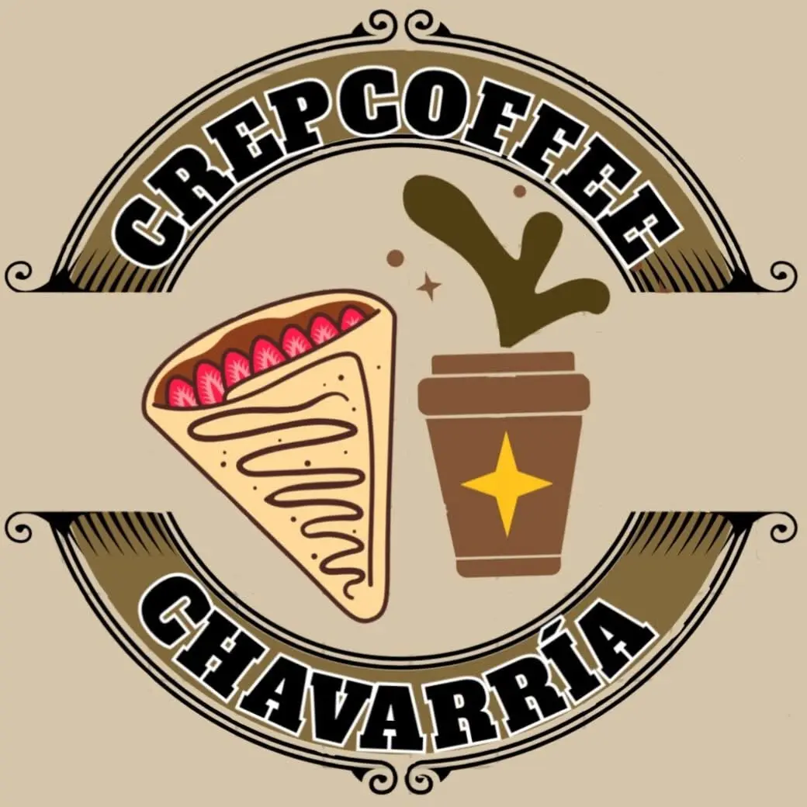

<div align="center">



# CrepCoffee Chavarría

Landing page informativa y responsive para un negocio local de alimentos y bebidas en Olomega, La Unión, El Salvador.

🔗 **[crepcoffeechavarria.com](https://crepcoffeechavarria.com)**

</div>

---

## Sobre el proyecto

Sitio web desarrollado para **CrepCoffee Chavarría** como proyecto social «Impulso Web Local» de la asignatura **Diseño Web Adaptable** (Laboratorio II, ciclo 02-2026) de la **Universidad de Oriente (UNIVO)**.

Presenta el negocio, su menú con precios, el horario y facilita los pedidos por WhatsApp. Es un sitio **estático e informativo**: no tiene carrito, pagos ni base de datos.

## Características

- Navegación fija con menú desplegable en teléfono y botón de WhatsApp siempre visible.
- Bebidas y menú en carruseles con nombre, descripción y precio.
- Sección «Nuestro lugar» con fotografías del local.
- Pasos para pedir y retirar en el establecimiento.
- Horario de atención en texto: viernes a domingo, 4:00 p. m. a 8:00 p. m.
- Pedido por WhatsApp con mensaje predefinido.
- Diseño responsive para teléfonos, tabletas y computadoras.
- Accesibilidad básica: enlace «Saltar al contenido», foco visible y texto alternativo.

## Tecnologías

HTML5 semántico · CSS3 (variables, Flexbox, Grid, media queries) · JavaScript vanilla · Google Fonts (Playfair Display y Poppins). Sin frameworks ni dependencias.

## Estructura

```text
ProyectoDiseno/
├── index.html        # Contenido y estructura
├── css/
│   ├── styles.css    # Estilos generales y responsive
│   └── header.css    # Encabezado y navegación
├── js/
│   └── main.js       # Menú y carruseles
├── img/              # Logotipo y fotografías
└── README.md
```

## Ejecutar localmente

```bash
git clone https://github.com/Kevenaxel/ProyectoDiseno.git
cd ProyectoDiseno
```

Abre `index.html` en el navegador, o usa la extensión **Live Server** de VS Code.

## Equipo

**Docente:** Ing. Alberto Turcios Ortez

- David Esau Alvarez Ventura
- Josue Enrique Moreno Blanco
- Iván Ezequiel Quintanilla Quintanilla
- Nelson René Rodriguez Quintanilla
- Kevin Mauricio Alvarenga Flores
- Ronaldo Dario Turcios Alvarez
- David Alexander Urias Blanco

---

<div align="center">Universidad de Oriente · 2026</div>
